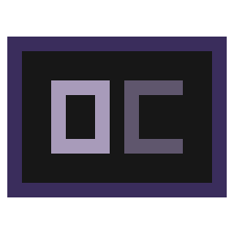

# 

Custom fork of opencode that focuses on building on existing features simply and cleanly, and adding new QOL features.

Not ready for widespread use until 0.3.0, especially on Linux and macOS. As of current date, testing and feature work is being done on Windows 10 LTSC IoT (i know lol). Linux and macOS feature parity is planned for v0.3.0.

Current version: [v0.2.292](https://github.com/fosterbarnes/oc/commits/main)

## Standout features

- Claude Code models in `/models`, using your own Claude Code login ([how](https://github.com/fosterbarnes/oc/wiki/Claude-Code))
- Cursor models in `/models`, using your Cursor login (beta) ([how](https://github.com/fosterbarnes/oc/wiki/Cursor))
- `oc <folder>` opens a ready session; `occ` reopens your last one ([how](https://github.com/fosterbarnes/oc/wiki/Launching#oc-and-occ))
- One background server shared by every window, so launches after the first are fast (beta) ([how](https://github.com/fosterbarnes/oc/wiki/Launching#background-server))
- One session list for every project ([how](https://github.com/fosterbarnes/oc/wiki/Sessions#session-list-and-marks))
- Mark sessions complete, failed, or in progress, and pin them (beta) ([how](https://github.com/fosterbarnes/oc/wiki/Sessions#session-list-and-marks))
- A sidebar with usage meters, sub-agents, a file tree, and changed files, all clickable ([how](https://github.com/fosterbarnes/oc/wiki/Sidebar))
- Run your project's scripts from the sidebar in one click ([how](https://github.com/fosterbarnes/oc/wiki/Sidebar#script-runner))
- `/commands` and skills reload as you edit them, no restart needed ([how](https://github.com/fosterbarnes/oc/wiki/Agents-and-Skills#commands-and-skills))
- Combine commands and skills in one prompt, like `/spit /think` ([how](https://github.com/fosterbarnes/oc/wiki/Agents-and-Skills#commands-and-skills))

## Quality of life

### Sessions
- `ctrl+return` on Home sends the prompt and keeps you on Home, so you can start several in a row
- New sessions name themselves after your first prompt (`<folder> - <task>`)
- Each session remembers its own model and reasoning level
- Agent questions survive closing the window: reopen the session and answer

### Launching
- `ctrl+n` picks a folder and starts a session there
- Startup animation with no blank gap before the app appears
- Faster startup for every command
- `/revive` restarts or rebuilds oc in place
- `/update` installs a new oc release and reopens where you were
- `opencode` runs every oc feature in one window with no background server, like stock OpenCode (beta)

### Claude Code
- The context % updates live during Claude Code turns
- Update Claude Code from the oc menu under Manage Third Party Harnesses
- Update Claude Desktop from the oc menu under Manage Third Party Harnesses (Windows only)

### Cursor
- Update Cursor CLI from the oc menu under Manage Third Party Harnesses
- Update Cursor Desktop from the oc menu under Manage Third Party Harnesses (Windows only)

### Codex
- Update Codex CLI from the oc menu under Manage Third Party Harnesses
- Update ChatGPT Desktop from the oc menu under Manage Third Party Harnesses (Windows only)

### Commands and tools
- Favorite `/commands` and skills with `ctrl+f`
- A `time` tool tells agents your local time for about 12 tokens

### Look and feel
- The terminal tab shows a square in the agent's color, plus busy and idle progress
- Replies show a timestamp and how long they took (beta)
- Double-click selects a word, triple-click a line, and copying keeps the highlight
- Reorder favorite models and hide models you never use
- Changed files open in the editor you pick for each file type

## Requirements

- Windows 10 or 11, x64
- PowerShell 7 (`pwsh`) on PATH

Some features need extra software:

| Feature | Needs |
|---|---|
| Claude Code models | Claude Code CLI (`claude`), installed and signed in |
| Cursor models | Node.js on PATH and a Cursor account |
| Sidebar file search | [Everything](https://www.voidtools.com/) running, with `es.exe` on PATH |
| Scripts opening in a new tab or split | WezTerm (first) or Windows Terminal; see [Terminal](#terminal) |
| `/revive` rebuilding oc | Bun (not 1.4.0) and a copy of oc's source |

## Terminal

WezTerm is the recommended terminal for oc. It is what the maintainer uses daily, so it gets the most oc features. Windows Terminal and the classic console (conhost) work; features they cannot support are hidden or reduced, not broken. WezTerm tab-color setup is in [docs/wezterm.md](docs/wezterm.md).

| Feature | WezTerm | Windows Terminal | Other |
|---|---|---|---|
| Colored tab square | Yes, with [tab-title setup](docs/wezterm.md) | Uncolored `■` in the title | Uncolored `■` in the title |
| Scripts in a tab, split, or window | Tab, split, or window | Tab, split, or window | New window only |
| Subagent session tabs | Yes | Yes | No |
| `/revive` restores all tabs in the window | Yes | Reopens one tab | Reopens one console |
| Shutdown of this instance | Closes owned WezTerm panes | Ends owned TUI processes | Ends owned TUI processes |

## Install

<!-- TODO(release): there is no public installer yet. The release zip has no oc.exe/occ.exe,
and .scripts/install.ps1 targets a fixed personal folder. Update these steps when that is fixed. -->

1. Download the latest `windows-x64` zip from [Releases](https://github.com/fosterbarnes/oc/releases).
2. Extract it to a folder you keep, for example `%LOCALAPPDATA%\oc`.
3. Add that folder to your PATH.
4. Open a new PowerShell 7 window and run `oc`.

The first launch starts the background server. Later launches connect to it, so they open faster.

To use Claude Code models, install and sign in to the Claude Code CLI first. To use Cursor
models, pick a Cursor model in `/models` and sign in through your browser.

## Behavior changes

Things that work differently from stock OpenCode:

- **Quitting:** `ctrl+c` clears the prompt and never quits. Quit with `ctrl+x q` or `/exit`.
- **Keys:** many keys differ ([Keybinds](https://github.com/fosterbarnes/oc/wiki/Keybinds)). Switch to stock OpenCode keys with **Keybind layout** in `ctrl+o`.
- **Closing the last window doesn't stop oc:** the background server keeps running, so the next
  launch opens where you left off. Stop it with `oc --kill-server` or from `ctrl+o`.
- **The session list shows every project,** not just the folder you're in. Picking a session opens
  it in its own folder.
- **oc sessions are named `<folder> - <task>`** after your first prompt, using `/rename`'s model.
- **Sending a prompt marks the session in progress.** Agents can't mark it complete or failed
  unless you allow it ([how](https://github.com/fosterbarnes/oc/wiki/Sessions#session-list-and-marks)).
- **No desktop app, web app, or opencode.ai services.** [SCOPE.md](SCOPE.md) lists everything oc
  leaves out or plans for later.

## Docs

How everything works is in the [wiki](https://github.com/fosterbarnes/oc/wiki):

- [Launching](https://github.com/fosterbarnes/oc/wiki/Launching): `oc`, `occ`, the background server, `opencode`, and `/revive`
- [Sessions](https://github.com/fosterbarnes/oc/wiki/Sessions): the session list, marks, and names
- [Sidebar](https://github.com/fosterbarnes/oc/wiki/Sidebar): usage, files, scripts, and sub-agents
- [Claude Code](https://github.com/fosterbarnes/oc/wiki/Claude-Code) and [Cursor](https://github.com/fosterbarnes/oc/wiki/Cursor): using your subscriptions
- [Agents and Skills](https://github.com/fosterbarnes/oc/wiki/Agents-and-Skills): commands, skills, and per-command permissions
- [Configuration](https://github.com/fosterbarnes/oc/wiki/Configuration): every setting oc adds
- [Troubleshooting](https://github.com/fosterbarnes/oc/wiki/Troubleshooting) and [FAQ](https://github.com/fosterbarnes/oc/wiki/FAQ)
- [Companion Tools](https://github.com/fosterbarnes/oc/wiki/Companion-Tools)
- [Developing](https://github.com/fosterbarnes/oc/wiki/Developing): building from source. Repo docs: [FORK.md](FORK.md), [SCOPE.md](SCOPE.md), [SCRIPTS.md](SCRIPTS.md), [UPSTREAM-SYNC.md](UPSTREAM-SYNC.md)

## Progress

[408,065](scc.txt) lines of code and counting...

<!-- code-count:start -->

| Language | Files | Lines | Blanks | Comments | Code |
|---|---:|---:|---:|---:|---:|
| Go | 5 | 917 | 55 | 5 | 857 |
| HTML | 1 | 1,161 | 79 | 0 | 1,082 |
| JavaScript | 9 | 1,454 | 129 | 53 | 1,272 |
| Nix | 3 | 258 | 23 | 26 | 209 |
| Powershell | 30 | 1,859 | 135 | 120 | 1,604 |
| SQL | 2 | 5 | 0 | 0 | 5 |
| Shell | 1 | 120 | 17 | 17 | 86 |
| TypeScript | 2,257 | 458,075 | 38,326 | 16,799 | 402,950 |
| **Total** | **2,308** | **463,849** | **38,764** | **17,020** | **408,065** |

<!-- code-count:end -->

## Why I made oc

[Read the writeup on the wiki](https://github.com/fosterbarnes/oc/wiki/Why-I-Made-oc).

## License and credits

MIT, see [LICENSE](LICENSE). oc is based on [OpenCode](https://github.com/anomalyco/opencode)
(MIT). The Cursor provider is derived from
[oakimov/cursor-opencode-provider](https://github.com/oakimov/cursor-opencode-provider) 0.6.7
(MIT); its license and notices are kept in `src/packages/opencode/src/provider/cursor/`.

oc is an unofficial project. It is not affiliated with or endorsed by the OpenCode team,
Anthropic, Cursor, or OpenAI. You are responsible for following each provider's terms.
